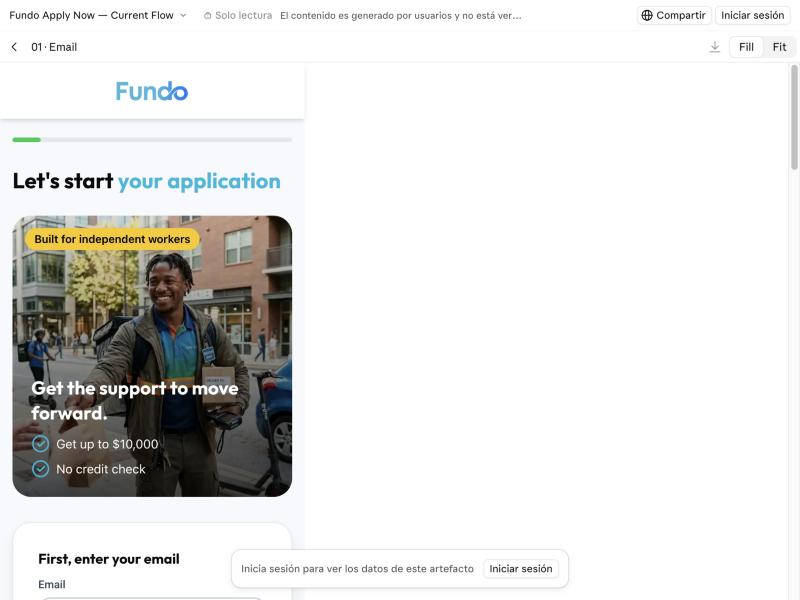
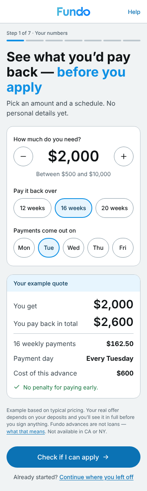

# Fundo — UI/UX Lead take-home

**Victoria Reguera** · Time spent: **about 3 hours** (one working session, 11 Nov 2026), against the brief's ~6-hour estimate — see *What's missing* below.

## The point in two minutes

**Fundo asks for trust before it gives information.** A customer on a phone is asked for email, phone, name, business details, address, date of birth and SSN — 12 screens — before Fundo says what the advance costs, how it's repaid, or whether they can get it at all. Customers in California or New York learn on screen 10 that Fundo can't serve them. Meanwhile the website, Apply Now, the portal and social media look and sound like four different companies.

**Top 5 issues** (ordered the way a customer decides — [full audit](./01-audit.md)):

1. **The cost is never shown** — no total payback, payment amount, frequency or cost in dollars on any surface. *Critical.*
2. **Eligibility is discovered too late** — state on screen 10; minimums never checked before SSN. *Critical.*
3. **The product's legal identity contradicts itself** — "merchant cash advance", "not a loan", "small business loans", "regulated financial service provider"; a path for wages and benefits income. *Critical, needs legal review.*
4. **No single brand** — six different taglines, pixelated logo and icons, different buttons and type on every channel, AI actors presented as customers in ads. *High.*
5. **The wizard gives no predictability or recovery** — no step count, no "what's next", no saved progress; the chat bubble covers the main button. *High.*

**What I improved.** Two layers ([Part 2](./02-improve.md)):
- **One design system for every Fundo channel**, built from the fundo.com brand — the one thing every channel already shares. It has light and dark modes and passes WCAG AA on all 46 text/background pairs ([Part 4](./04-design-system.md), [tokens](./tokens/)).
- **Apply Now's first screen becomes a simulator plus an eligibility check.** Customers see what they'd pay back and whether they can apply **before** giving any personal data. Unfundable applications end in 30 seconds with a clear reason, and everyone else gets a map of the 7 steps and saved progress.

| Before | After |
|---|---|
|  |  |
| *Before — screen 01 asks for email; the cost is never shown.* | *After — the simulator (working React app at 360 px): cost and payments first, no personal data.* |

## Deliverables

| | Where |
|---|---|
| Part 1 — Audit | [01-audit.md](./01-audit.md) · evidence in [`/evidence`](./evidence) |
| Part 2 — Improve | [02-improve.md](./02-improve.md) |
| Claude Design canvas | Before, the full after-flow at 360 px, branches, edge cases and dark mode: [Fundo Apply Now — Redesign](https://claude.ai/artifact/WmGXVX7D62NAtjbsDhzfLY) · source in [`/design`](./design) |
| Working app (React + TypeScript) | [`/app`](./app) — `cd app && npm install && npm run dev` · [app README](./app/README.md) |
| Part 3 — Prove it | [03-prove-it.md](./03-prove-it.md) |
| Part 4 — Design system | [04-design-system.md](./04-design-system.md) · [tokens](./tokens) · [specimen](./tokens/specimen.html) · [brand-review skill](./skills/fundo-brand-review/SKILL.md) |

## How I worked with AI

**Tools and what each did**

| Tool | Used for |
|---|---|
| **Claude** (this conversation, Claude Code tools) | Research (Finder, Nav, Protect Borrowers), audit structure and first drafts, copy, token generation and contrast checks, the React app, tests |
| **Claude in the built-in browser** | Walking the prototype screen by screen, fundo.com and the portal at 360 px, screenshots |
| **Claude Design** | The canvas: before/after, 13 artboards, the interactive simulator and branches |
| **Playwright + esbuild** (in the sandbox) | Building the app and checking 49 behaviours end to end at 360 px |

I directed and corrected; Claude drafted and built. Social channels were reviewed by me, logged in, because Instagram hides the profile from logged-out visitors.

**Real prompts** (my words, from the session; originals in Spanish)

> *"For the design system let's use the website's tokens, not the wizard's. Headings in Outfit, a semantic scale based on 1rem/16px, text in Roboto, primary #0e90e4 (build the scale varying lightness +10/−10); neutrals come from this colour. Semantic palette (success, error, warning) with its scale. Semantic tokens (surface, on-surface, text, primary…). Dark mode."*

> *"The selects for long lists, like state, should be autocomplete… the chevron is stuck to the right margin, respect the padding. Show which fields are required. If the user leaves after entering their email, tell them they can resume from the email. Date of birth should be a calendar. Phone with a country selector. If the majority owner is someone else, let them share the quote by email."*

> *"Let's go to code: a functional React TypeScript implementation covering every edge case, state and error message. Responsive."*

> *"Why would you test with the Claude Design artifact and not the working prototype?"*

**Where the AI got it wrong, and how it was caught**

| What went wrong | How it was caught | Fix |
|---|---|---|
| Audit said the wizard's primary button was "inconsistent"; it is a correct disabled state | My review | Rewritten as an accessibility issue (disabled with no hint, low contrast) |
| First top-5 put legal identity before eligibility and treated brand as "contradictory promises" | My review: customers ask "can I get it?" before "do I trust it?"; the brand problem is holistic | Re-ranked by the customer's decision order; brand issue rewritten across all channels |
| Square Loans facts came from model memory, not a source | Self-flagged during the audit | Marked as unverified in the audit's assumptions |
| Screenshot redaction boxes landed in the wrong place (retina images at a different scale) | Viewing the output | Recomputed at real resolution; checked again |
| Dark-mode disabled button had the same colour as the card — invisible | Rendering the token specimen | `action.disabled` dark mapped to a lighter neutral |
| Progress said "Step x of 5" while the step map listed 5 steps *after* step 2 | Noticed while building the canvas | Changed to an honest 7 steps across all screens and docs |
| Canvas screens scrolled sideways at 360 px | My review in Claude Design | Fluid widths; the app's E2E suite now checks 360 and 320 px |
| Research plan used the static canvas instead of the working app | My question | Research now runs on the deployed app |
| **Saving never advanced to the next screen** (React StrictMode remount) | E2E test | Hook re-marks itself mounted on every mount |
| **Typing "Texas" + Enter picked California** | E2E test | Combobox filters only while typing |
| **Typing over a chosen state cleared the field** | E2E test | Selection sync no longer wipes typed text |

**How the work was verified**
- **Audit:** every claim links to a screenshot or source. Third-party pricing is marked as such, and claims needing legal review are listed.
- **Tokens:** a script checks 46 contrast pairs in both modes and fails the build if any pair falls below AA ([report](./tokens/contrast-report.md)).
- **App:** strict type-check of all logic, 11 unit tests, and **49/49 end-to-end checks** in headless Chrome ([last run](./app/e2e/last-run.txt), [screens](./app/e2e/screens)).
- **Personal data:** none in the deliverable. The reviewer's name and third-party accounts are redacted from social screenshots, the SSN is never stored in the browser, and no analytics event carries personal data.

## What's missing (honestly)

- **Time:** about 3 hours instead of ~6, so these are lighter:
  - The Facebook and LinkedIn review is visual only.
  - Email and SMS communications couldn't be seen without applying.
  - The blog post was reviewed through the blog index and its Facebook shares rather than read in full.
- **No customer research was run.** Part 3 is the plan.
- **Pricing in the simulator is an illustrative rate card** (12 wk × 1.25, 16 wk × 1.30, 20 wk × 1.35). Fundo doesn't publish rates.
- **Copy pending compliance:** the credit-impact sentence ("doesn't affect your credit score"), failed-payment wording, and the speed claim.
- **App:**
  - Address autocomplete and the backend are mocked.
  - Bank connection and the offer are out of scope, as in the prototype.
  - The React components still need a `tsc` run after `npm install`: the sandbox had no network access for type packages.
- **The Claude Design canvas is private until shared.** Share it from its Share menu before sending.
